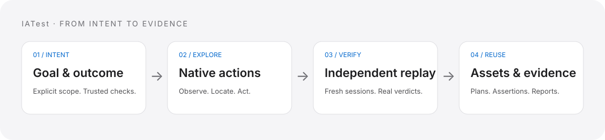

<div align="center">

# IATest

### Describe the goal. Explore the app. Verify the outcome.

AI-driven testing for APIs, browsers, desktop and mobile apps — with performance, security, data and protocol checks in the same workflow.

[](https://pypi.org/project/iatest-framework/)
[](https://pypi.org/project/iatest-framework/)
[](https://github.com/hinayoung23/IATest/actions/workflows/test.yml)
[](LICENSE)

English · [简体中文](README.zh-CN.md)

[Quick start](#quick-start) · [How it works](#how-it-works) · [What you can test](#what-you-can-test) · [Examples](#examples) · [FAQ](#faq) · [Documentation](docs/README.md)

</div>

IATest turns a business goal into an observed UI journey, independent replay and a reusable test plan. It also imports API contracts, runs bounded load and security checks, validates data and messages, and connects those tests into larger business workflows.

Use the local Web console or CLI. Keep goals, cases, plans, rules and measurement assets together. Review original assertions and evidence alongside any AI explanation.

Version 2.1.1 hardens console sessions, credential destinations and configuration updates, and adds explicit assessment counts and release quality gates. Read the [upgrade notes](docs/releases/2.1.1.md) and [console security guide](docs/guides/console-security.md). The file asset layout introduced in [2.1.0](docs/releases/2.1.0.md) remains compatible.



## Quick start

Requires **Python 3.11+**. Extra tools depend on the target you test.

```sh
python -m pip install "iatest-framework==2.1.1"
mkdir my-tests
cd my-tests
iatest init --project demo
iatest web --project demo
```

Open the one-time **authorization link printed by `iatest web`**. Enroll a model origin and credential reference locally with `iatest llm-trust`, then select that connection in **Settings**. See the [connection setup](docs/guides/console-security.md). Then open **Test workspace → UI & interaction**:

1. Choose a browser, Android, iPhone/iPad or desktop target.
2. Describe the business goal and a concrete expected outcome.
3. Start AI goal exploration and review the independent replay results.
4. Open the saved case and plan in **Test assets → UI tests**.

For example:

> Set the nickname to “Test User”, save it, then reload the page. The test passes only if the nickname still equals “Test User”.

No selectors or complete click script are required for this entry path. You supply the target and trusted expectation; IATest discovers the steps. Starting exploration uses the configured model and acts on the target application.

Browsers need an installed Chromium-family browser or a supported WebDriver backend. Native mobile and desktop tests need the platform tools and permissions in the [environment guide](docs/reference/environment.md).

### Run a test without an AI model

Create `records.json`:

```json
{
  "id": "unique-records",
  "kind": "data",
  "spec": {
    "records": [{"id": 1}, {"id": 2}],
    "checks": [{"id": "unique-id", "rule": "unique", "path": "$.id"}]
  }
}
```

```sh
iatest test import-plan records.json --project demo
iatest test run unique-records --project demo
iatest test reports --project demo
```

Saved deterministic plans run without model calls. AI is used when you request exploration, generation, visual assistance or evidence analysis.

For complete API, data and browser examples, including CI exit semantics, see [deterministic execution](docs/guides/deterministic-ci.md).

## How it works

**Goal → observed actions → independent replay → reusable assets → evidence.**


- **Declare the outcome.** Checks cite your goal and trusted rules before state-changing actions. Current screen contents do not become the expected answer.
- **Observe and explore.** Bounded native or browser tools locate controls and execute authorized actions. Manual step composition is also available.
- **Replay independently.** UI exploration performs at least two fresh-session replays. Stable success and stable business failure are recorded separately; incomplete cases remain candidates.
- **Reuse the plan.** Saved plans can run again, join workflows, execute on authorized nodes or become part of release verification.
- **Keep the evidence.** Assertions, screenshots, measurements, errors and cleanup results remain distinct from model interpretations.

The console separates **Test workspace**, **Devices & environments**, **Test assets**, **Runs & reports**, **Project knowledge** and **Settings**. The asset library treats UI, API, performance and security assets consistently, with filtering and links between goal cases and compiled plans.

Project assets follow `projects/<project>/assets/<test-type>/`: API, Web, desktop, Android, iOS, performance and security each have readable plan, case and rule files. Results and evidence live under `reports/<test-type>/`; SQLite provides rebuildable query views and internal state. Existing layouts migrate without deleting the originals. See [project storage and migration](docs/guides/project-assets.md).

## What you can test

| Target | Capabilities | Preparation |
|---|---|---|
| APIs | Contract import, AI-assisted case design, authentication, fixtures, data-driven cases, Mock and reports | Authorized HTTP service; a model for generation |
| Browser UI | Goal exploration, native input, frames, pages, Shadow DOM, screenshots and visual targets | Installed browser/driver and explicit network policy |
| Desktop apps | macOS AX, Windows UIAutomation, Linux AT-SPI; controls, keys, drag, scroll and screenshots | Running app, app/process identity and accessibility permissions |
| Android | Native input, IME, gestures, WebView, video, app delivery and scoped metrics | Android SDK/JDK, authorized ADB and framework components |
| iOS | XCTest input, USB or TLS observation, WKWebView, video and explicit measurements | macOS/Xcode, developer mode and trusted signed Runner |
| Performance | HTTP/transaction load, protocol sessions, LAN workers and client metric gates | Authorized environment, bounded load and compatible collectors |
| Security & accessibility | Explicit authorization checks, rule-driven scans, automated accessibility checks and human review | Declared scope, identities and relevant review evidence |
| Data & protocols | Read-only SQLite/PostgreSQL/MySQL, data quality, WebSocket, MQTT and structured gRPC | Authorized sources/services; optional database drivers |
| Business workflows | Typed dependencies, concurrency, cleanup, resource ownership, remote nodes and release suites | Saved plans and explicit node/resource configuration |

```sh
iatest test capabilities
iatest test doctor
iatest mobile doctor
```

Platform support has specific boundaries. Safari uses an explicit navigation-only mode; some Apple raw collectors remain unreliable; BLE digitizer reports are experimental; physical phones do not provide full OS isolation. See the [capability matrix](docs/reference/capabilities.md) before selecting a backend.

### Optional dependencies

```sh
# PostgreSQL/MySQL drivers and SQL authorization checks
python -m pip install "iatest-framework[database]==2.1.0"

# Pinyin support for the optional HID Chinese-input channel
python -m pip install "iatest-framework[hid]==2.1.0"
```

These extras do not install browsers, Android SDKs, Xcode or HID hardware.

## Examples

| Scenario | Start here |
|---|---|
| Explore a profile-editing UI | [UI goal lab](examples/ui_goal_lab.py) · [Goal exploration guide](docs/guides/goal-exploration.md) |
| Combine UI, HTTP, performance and security | [Automation lab](examples/automation_lab.py) · [Test plans](examples/plans) |
| Import an API contract | [API service](examples/api_service.py) · [OpenAPI contract](examples/api_contract.json) |
| Configure a phone or emulator | [Device profiles](examples/devices) · [Mobile testing](docs/guides/mobile-testing.md) |
| Work with measured data or HID | [Measurements](examples/measurements) · [HID examples](examples/hid) |

The UI lab includes a deliberately broken save path for comparison. Demo services bind to loopback; replace their addresses and identities before testing your own environment. Examples are source-repository resources; installed users can start directly from the console or the JSON plan above.

## FAQ

**Do all tests need an AI model?**

No. Saved plans and deterministic checks execute without a model. Exploration, generation and AI analysis require a compatible configured provider.

**Is a finished task a passed test?**

No. Task lifecycle and verdict are separate. Missing measurements, ambiguous targets, incomplete observation and unknown input delivery cannot pass. AI analysis does not replace the original verdict.

**Is everything local?**

The console, execution and asset storage run locally. Requested model operations send selected context, and explicitly enabled images, to your configured provider. Its data policy applies. Keep credentials in environment-variable references.

**Do mobile tests need Appium or a jailbroken iPhone?**

The framework owns its native drivers and does not require Appium. Standard iOS testing uses a signed XCTest Runner. Optional Android-to-iPhone Bluetooth HID and USB HID channels have their own setup and compatibility requirements.

**Does installing the package complete device setup?**

No. Browser drivers, mobile SDKs, signatures, native components, interactive desktops and hardware permissions are target-specific. Start with the environment and platform guides.

**What changed in 2.0?**

The Python package is now `iatest`; update imports and `python -m ai_apitest` to `python -m iatest`. The PyPI distribution remains `iatest-framework` and the command remains `iatest`. Examples and console filenames now describe the wider testing scope. See [release and migration notes](docs/releases/2.0.0.md).

## Documentation

- [Documentation index](docs/README.md) · [Getting started](docs/guides/getting-started.md) · [Web console](docs/guides/web-console.md)
- [UI goal exploration](docs/guides/goal-exploration.md) · [Browser](docs/guides/browser-testing.md) · [Desktop](docs/guides/desktop-testing.md) · [Mobile](docs/guides/mobile-testing.md)
- [Test plans & workflows](docs/guides/test-plans.md) · [Performance & security](docs/guides/performance-security.md) · [Data & protocols](docs/guides/data-protocol.md)
- [Architecture](docs/design/architecture.md) · [Knowledge & agents](docs/guides/agent-data.md) · [Capability boundaries](docs/reference/capabilities.md)

## Development

```sh
git clone https://github.com/hinayoung23/IATest.git
cd IATest
python -m venv .venv
# Activate .venv using your shell's normal command.
python -m pip install -e ".[test,database,hid]"
python -m pytest -q
```

Browser and native integration tests require their documented environments; skipped tests are not device acceptance. Generated projects, credentials, recordings and build products are excluded from source control and release packages. See [CONTRIBUTING](CONTRIBUTING.md) for layout and release checks.

Licensed under [Apache-2.0](LICENSE).
