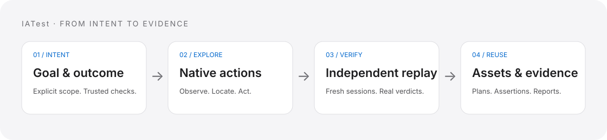

<div align="center">

# IATest

### 说清测试目标，让 AI 探索路径，用独立回放验证结果。

覆盖 API、浏览器、桌面、移动端，以及性能、安全、数据与协议的 AI 自动化测试框架。

[](https://pypi.org/project/iatest-framework/)
[](https://pypi.org/project/iatest-framework/)
[](https://github.com/hinayoung23/IATest/actions/workflows/test.yml)
[](LICENSE)

[English](README.md) · 简体中文

[快速开始](#快速开始) · [工作方式](#工作方式) · [测试范围](#测试范围) · [示例](#示例) · [常见问题](#常见问题) · [文档](docs/README.md)

</div>

IATest 把业务目标连接为真实界面操作、独立回放和可复用测试计划，也支持导入 API 契约、执行有限负载和安全检查、验证数据与消息，并将不同类型的测试组合为完整业务流程。

通过本地 Web 控制台或 CLI 使用。目标、用例、计划、规则和指标资料统一管理；原始断言与证据和 AI 解读分别呈现。

2.1.1 加固控制台会话、凭据发送目标和配置并发更新，补充明确的检查计数与发布质量门禁。升级前请阅读[2.1.1 说明](docs/releases/2.1.1.md)和[控制台安全指南](docs/guides/console-security.md)。[2.1.0](docs/releases/2.1.0.md) 引入的文件资产布局保持兼容。



## 快速开始

需要 **Python 3.11+**。浏览器、手机和桌面测试按目标另行准备环境。

```sh
python -m pip install "iatest-framework==2.1.1"
mkdir my-tests
cd my-tests
iatest init --project demo
iatest web --project demo
```

打开 **`iatest web` 打印的一次性授权链接**。先通过本机 `iatest llm-trust` 登记模型目标和凭据引用，再在「设置」中选择同一连接，详见[连接配置](docs/guides/console-security.md)。然后打开「测试工作台 → 界面与交互」：

1. 选择浏览器、Android、iPhone/iPad 或桌面应用。
2. 填写业务目标，以及怎样才算通过。
3. 开始 AI 目标探索，查看独立回放结果。
4. 在「测试资产 → UI 测试」管理目标用例和关联计划。

例如：

> 把昵称改为“测试昵称”并保存，再刷新页面。只有刷新后昵称仍等于“测试昵称”，才算通过。

这一入口无需手写控件标识和完整点击脚本。你提供目标与可信预期，框架探索操作路径。开始探索会使用已配置模型，并实际操作目标应用。

浏览器需要已安装的 Chromium 或受支持的 WebDriver 后端；原生移动和桌面测试需要对应工具与权限，见[环境指南](docs/reference/environment.md)。

### 不连接模型也能运行测试

创建 `records.json`：

```json
{
  "id": "unique-records",
  "kind": "data",
  "spec": {
    "records": [{"id": 1}, {"id": 2}],
    "checks": [{"id": "unique-id", "rule": "unique", "path": "$.id"}]
  }
}
```

```sh
iatest test import-plan records.json --project demo
iatest test run unique-records --project demo
iatest test reports --project demo
```

已保存的确定性计划不调用模型；目标探索、生成、视觉辅助和证据分析按请求使用模型。

## 工作方式

**业务目标 → 真实观察与操作 → 独立回放 → 可复用资产 → 执行证据。**


- **先明确预期**：检查项在改变状态之前引用用户目标和可信规则，页面当前内容不会自动成为预期。
- **观察并探索**：通过有范围和预算约束的原生/浏览器工具定位与操作，也可切换手工编排。
- **独立回放**：UI 探索至少执行两次新会话回放；稳定通过和稳定业务失败分别记录，未完成结果保留候选状态。
- **复用计划**：计划可再次运行、组合为业务流程、交给授权节点或纳入版本验证。
- **核对证据**：断言、截图、测量、错误及清理结果与模型解释分别保存。

控制台区分测试工作台、设备与环境、测试资产、执行与报告、项目知识和设置。资产库按 UI、接口、性能、安全等类型统一展示资料，目标用例与固化计划保留关联。

磁盘结构统一为 `projects/<项目>/assets/<测试类型>/`：接口、Web、桌面、Android、iOS、性能和安全各自保存可读的计划、用例、规则文件。结果与证据位于 `reports/<测试类型>/`，SQLite 保留可重建查询缓存及内部状态。旧结构兼容迁移并保留原件，详见[项目资产与目录](docs/guides/project-assets.md)。

## 测试范围

| 场景 | 能力 | 需要的准备 |
|---|---|---|
| API | 文档导入、AI 用例设计、鉴权、夹具、数据驱动、Mock、报告 | 授权 HTTP 服务；生成时配置模型 |
| 浏览器 | 目标探索、原生输入、frame、页面、Shadow DOM、截图、视觉定位 | 已安装浏览器/驱动、明确网络策略 |
| 桌面 | macOS AX、Windows UIAutomation、Linux AT-SPI；控件、键盘、拖拽、滚轮、截图 | 运行中的应用、进程/应用身份、辅助权限 |
| Android | 原生输入、IME、手势、WebView、视频、应用交付与平台指标 | SDK/JDK、授权 ADB、框架原生组件 |
| iOS | XCTest、USB/TLS 观察、WKWebView、视频与显式测量 | macOS/Xcode、开发者模式、受信任签名 Runner |
| 性能 | HTTP/事务负载、协议会话、局域网节点与客户端指标门禁 | 授权测试环境、有限负载和兼容采集器 |
| 安全与无障碍 | 明确授权检查、规则扫描、自动检查及人工复核 | 声明范围、身份和必要人工证据 |
| 数据与协议 | SQLite/PostgreSQL/MySQL 只读数据、质量检查、WebSocket、MQTT、结构化 gRPC | 对应数据源/服务；网络数据库可选依赖 |
| 业务流程 | 类型化依赖、并发、清理、资源所有权、远程节点和版本任务 | 已保存计划、明确节点及资源配置 |

```sh
iatest test capabilities
iatest test doctor
iatest mobile doctor
```

平台支持有明确范围：Safari 使用显式常规模式，部分 Apple 原始采集器仍不稳定，BLE digitizer 为实验能力，物理手机不提供完整系统隔离。选择后端前请阅读[能力矩阵](docs/reference/capabilities.md)。

### 可选依赖

```sh
python -m pip install "iatest-framework[database]==2.1.1"
python -m pip install "iatest-framework[hid]==2.1.1"
```

`database` 提供 PostgreSQL/MySQL 驱动与 SQL 授权检查；`hid` 提供可选 HID 中文输入所需拼音支持。这些依赖不会安装浏览器、Android SDK、Xcode 或外接硬件。

## 示例

| 工作 | 入口 |
|---|---|
| 探索昵称保存和刷新流程 | [UI 目标实验应用](examples/ui_goal_lab.py) · [目标探索指南](docs/guides/goal-exploration.md) |
| 组合界面、HTTP、性能和安全检查 | [综合实验服务](examples/automation_lab.py) · [测试计划](examples/plans) |
| 导入接口契约 | [API 示例服务](examples/api_service.py) · [OpenAPI 示例](examples/api_contract.json) |
| 配置手机或模拟器 | [设备配置](examples/devices) · [移动端指南](docs/guides/mobile-testing.md) |
| 使用测量资料或 HID | [测量示例](examples/measurements) · [HID 示例](examples/hid) |

UI 示例包含保存失败的对照路径。实验服务仅监听本机回环地址；测试自己的环境时替换地址与身份。示例属于源码仓库资源，安装包用户可以直接使用控制台，或运行上面的独立 JSON 计划。

## 常见问题

**所有测试都依赖模型吗？**

不依赖。已有计划与确定性检查直接执行；探索、生成和 AI 分析需要相应模型能力。

**后台任务完成，就说明测试通过吗？**

不说明。任务生命周期与测试判定分别记录。缺测、目标歧义、观察不完整和未知投递不能通过；模型分析不能修改原始判定。

**数据完全在本地吗？**

控制台、执行与资产存储在本地。请求模型能力时，选定上下文及显式启用的图像会发送到配置的模型服务，适用该供应商的数据政策。凭据使用环境变量引用。

**手机测试需要 Appium 或越狱吗？**

不需要 Appium；框架使用自身原生驱动。常规 iOS 测试使用签名 XCTest Runner。安卓到 iPhone 的蓝牙 HID、USB HID 有各自硬件、授权和兼容要求。

**安装 Python 包后就能直接操作所有设备吗？**

还需要目标环境的浏览器驱动、SDK、签名、原生组件、交互桌面或硬件权限。先按平台指南准备和检查环境。

**2.0 的命名变化是什么？**

Python 包改为 `iatest`，将旧 `ai_apitest` 导入以及 `python -m ai_apitest` 改为 `iatest`。PyPI 安装名仍为 `iatest-framework`，命令仍为 `iatest`。示例、页面和指南按更广的测试范围命名，见[2.0.0 版本与迁移说明](docs/releases/2.0.0.md)。

## 文档与开发

- [文档首页](docs/README.md) · [第一个项目](docs/guides/getting-started.md) · [控制台指南](docs/guides/web-console.md)
- [目标探索](docs/guides/goal-exploration.md) · [浏览器](docs/guides/browser-testing.md) · [桌面](docs/guides/desktop-testing.md) · [移动端](docs/guides/mobile-testing.md)
- [测试计划与编排](docs/guides/test-plans.md) · [性能与安全](docs/guides/performance-security.md) · [数据与协议](docs/guides/data-protocol.md)
- [架构](docs/design/architecture.md) · [知识与 Agent](docs/guides/agent-data.md) · [能力边界](docs/reference/capabilities.md)

```sh
git clone https://github.com/hinayoung23/IATest.git
cd IATest
python -m venv .venv
# 使用当前 Shell 的方式激活虚拟环境。
python -m pip install -e ".[test,database,hid]"
python -m pytest -q
```

平台专项需要对应环境；跳过测试不等于真机验收。生成项目、凭据、录制与构建产物不进入版本控制或分发包。目录说明及验证约定见 [CONTRIBUTING](CONTRIBUTING.md)。

采用 [Apache-2.0](LICENSE) 许可证。
