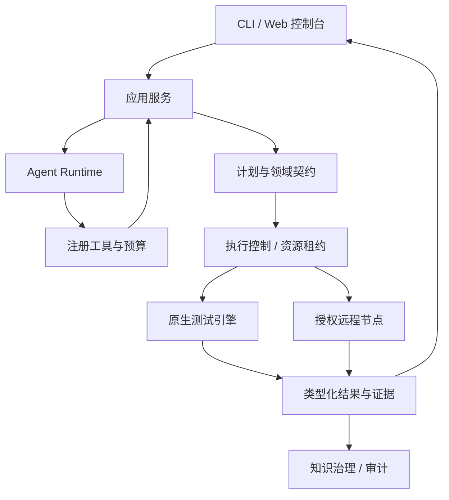

# 总体架构

## 产品模型

IATest 是本地运行、可连接局域网节点的自动化测试框架。CLI 与 Web 共用应用服务，应用服务生成或运行版本化计划，原生引擎执行已授权动作，结果以确定性断言和证据为准。AI 负责规划、探索、分析和知识治理，不直接替代执行器判定。

## 模块职责

| 目录 | 职责 |
|---|---|
| `application/` | 接口识别、用例生成/维护、目标探索、分析、安装资产、版本任务等用例编排 |
| `core/` | 配置、路径、Schema、资源身份与统一脱敏 |
| `agents/`、`ai/` | 角色、模型网关、工具循环、检查点和用量账本 |
| `tools/`、`domain/` | 工具契约、权限和领域操作 |
| `engines/` | HTTP、Web、桌面、数据、协议、性能、安全、无障碍和工作流引擎 |
| `execution/` | 预算、取消、鉴权、数据、夹具、进程/容器 worker 与原生 RPC |
| `mobile/` | 设备配置、原生 Runner、媒体、HID、测量与平台适配 |
| `nodes/` | 节点身份、TLS、分布式执行、资源协调与 fencing |
| `context/`、`agents/memory.py` | SQLite 知识、来源、冲突、上下文注入和运行记忆 |
| `web/` | 回环 HTTP 服务、服务端模板、后台任务及本地静态资源 |

## 两条执行路径

API 文档导入后产生规范化契约，规划与设计工具生成 Markdown 用例。编译门禁检查接口引用、请求契约、断言、数据依赖和可信业务规则，执行器运行通过门禁的资产。

类型化测试使用 `contract_version/id/kind/spec/budget`。引擎注册表做类型分派，`RunControl` 统一处理预算和取消。工作流在控制端持有 DAG、类型化输出和资源关系；叶节点使用相应引擎或授权远程 worker。

## AI 与原生执行

主控、生成、分析角色通过模型网关解析配置。Agent 只能使用角色允许的注册工具；模型输出必须符合工具 Schema、应用规则及预算。任意 shell、任意浏览器脚本和模型生成执行器不作为计划能力开放。

目标探索在实际应用中观察和执行，冻结业务目标后固化真实轨迹，再独立回放。语义定位优先，局部图像定位显式启用；稳定计划不依赖每步模型推理。

## 原生平台

- Chromium 使用自有 CDP 客户端，Firefox/Safari 使用 W3C WebDriver。
- 桌面使用 AX、UIAutomation 或 AT-SPI；Wayland 完整模式经系统门户输入和单应用 GNOME 组件读取窗口。
- Android 使用授权 ADB、shell 输入组件及原生探针；iOS 使用已签名 Runner，观察可经 USB 或独立 TLS。
- HID 发送与观察独立，报告回执不等于目标系统执行成功。

平台适配提供完整性、身份与派发状态，不能把缓存或截断结果当成唯一目标。权限撤销、服务代次和进程身份变化会使旧输入上下文失效。

## 状态与存储

`iatest.json` 保存配置；`projects/<project>/` 保存接口、用例、计划、运行结果、证据和知识。模型、节点和设备凭据使用环境引用。类型化资产、测量、库与人工复核按来源和摘要绑定，不能以新内容静默覆盖原始证据。

资产正文统一位于 `assets/<测试类型>/`，按 plans、cases、rules 等分类保存可读 JSON/Markdown。`reports/<测试类型>/` 保存结果和证据；`.iatest/indexes/` 中的 SQLite 是可重建查询视图，任务、知识和 Agent 数据仍使用各自的状态存储。文件变更由独立存储锁和持久事务快照保护，兼容读取旧数据库并保留原始数据。具体目录和迁移规则见[项目资产与目录](../guides/project-assets.md)。

上下文数据库保存可治理知识；Agent 检查点用于受控恢复；后台任务有持久状态和取消入口。未知写入不自动重放，清理也需要明确范围。

## 隔离与分布式

应用访问策略、独立进程和容器是不同边界。进程模式不等于操作系统权限沙箱；物理手机不宣称拥有完整系统隔离。浏览器 RPC 将原生句柄留在 worker，模型与共享预算留在父端。

远程节点使用 TLS、身份和本地能力限制。分布式负载分片全局份额并汇总原始样本。资源协调可使用 SQLite，或配置固定 etcd 集群及副本；多数派不可用时拒绝新租约，未知占用保留到对账。

参见[能力边界](../reference/capabilities.md)、[上下文设计](context.md)、[执行隔离](../guides/sandbox.md)。
